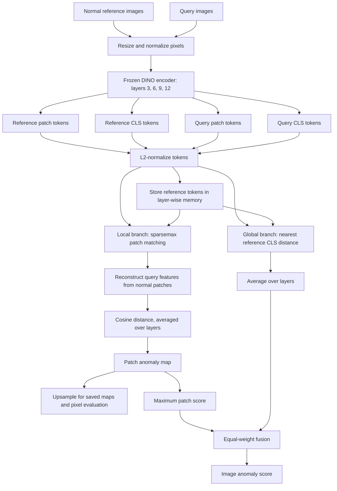

# Hyper-FSAD

My PyTorch implementation of **Hyper-FSAD: Training-Free and Language-Free Few-Shot Anomaly Detection via Sparse Hyper Matching**. I built this project to understand how a frozen vision model can detect defects using only a few normal examples.

Paper: [arXiv:2605.10628v2](https://arxiv.org/abs/2605.10628v2), August 2026, by Guohuan Xie, Xin He, Dingying Fan, Siqi Li and Yun Liu.

This is an **unofficial implementation**. The core method is implemented, but I have only evaluated it on the bottle category of MVTec AD so far. It is not a reproduction of all the paper's experiments.

## What it does

The model takes a few normal images as references and compares a new image against them. It returns an image-level anomaly score and a map of the areas that look unusual.

1. Extract patch and CLS tokens from layers 3, 6, 9 and 12 of a frozen DINO encoder.
2. Store the normal reference tokens in a separate memory bank for each layer.
3. Use sparsemax to select and weight normal patches for reconstructing each query patch.
4. Calculate local anomaly scores from the cosine distance between query patches and their reconstructions.
5. Combine the maximum local score with the nearest-reference CLS distance, using equal weights.

There is no fine-tuning, text prompt or training loop. `fit()` just stores the normal features. Higher scores mean the image differs more from the normal references; they are not probabilities.

## Start here: the basic terms

Imagine showing the program a photo of an undamaged bottle and then asking it to inspect another bottle. It compares the new image with what it saw in the normal one. It does not need examples of every possible defect.

| Term | Meaning here |
|---|---|
| Support image / reference | A normal image used as an example of what is expected. |
| Query image | The new image we want to inspect. |
| Shot | One reference image. A 4-shot run uses four normal references. |
| Encoder / backbone | The pretrained DINO network that turns an image into lists of numbers. |
| Feature vector / token | A list of numbers describing visual information learned by DINO. |
| Patch token | A feature associated with one small region of the image. It can also contain information from surrounding regions. |
| CLS token | A special feature that summarizes the whole image. |
| Layer | One processing stage inside DINO. We read four different stages. |
| Tensor | A multidimensional array of numbers, like a table with extra dimensions. |
| Memory bank | The stored features of the normal references, not a database of defect examples. |
| Anomaly map | A grid of scores showing where the query differs from the references. |
| Ground-truth mask | The dataset's answer image: marked pixels show the actual defects. It is used for evaluation, not prediction. |

“Training-free” means we do not update the encoder for this task. DINO itself was already pretrained by its authors.

## What each file does

| File | What to look for |
|---|---|
| [`hyper_fsad/__init__.py`](hyper_fsad/__init__.py) | Makes the main classes available through imports such as `from hyper_fsad import HyperFSAD`. |
| [`hyper_fsad/backbone.py`](hyper_fsad/backbone.py) | Loads DINO, prepares images, reads the selected layers, and separates patch features from the whole-image CLS features. |
| [`hyper_fsad/core.py`](hyper_fsad/core.py) | Contains the method itself: `Features` stores tokens, `sparsemax()` finds matching weights, `HyperFSAD.fit()` stores normal references, `predict()` computes scores, and `Prediction` holds the output. |
| [`hyper_fsad/cli.py`](hyper_fsad/cli.py) | Runs inference on image folders through `hyper-fsad`. It reads files, chooses references, calls the encoder and detector, then saves scores and maps. |
| [`hyper_fsad/evaluate.py`](hyper_fsad/evaluate.py) | Runs `hyper-fsad-evaluate` on MVTec AD. It loads labels and masks, checks predictions against them, and saves metrics for each category and seed. |
| [`tests/test_core.py`](tests/test_core.py) | Checks the matching and scoring math using small examples with known answers. |
| [`tests/test_backbone.py`](tests/test_backbone.py) | Checks that the DINO adapters return the right token shapes and keep weights frozen. |
| [`tests/test_cli.py`](tests/test_cli.py) | Runs folder inference with a tiny test checkpoint and checks the output files. |
| [`tests/test_evaluate.py`](tests/test_evaluate.py) | Checks dataset loading, masks, metric calculations, and repeatable support selection. |
| [`pyproject.toml`](pyproject.toml) | Lists package dependencies and connects the two terminal commands to their Python `main()` functions. |
| [`requirements-tested.txt`](requirements-tested.txt) | Records the package versions used during testing. |
| [`RESULTS.md`](RESULTS.md) | Explains the completed bottle experiments and their limitations. |
| [`benchmarks/`](benchmarks/) | Contains one run JSON and one summary JSON for each tested backbone. Run files list every image prediction; summaries record settings, model revisions, and aggregate scores. |
| [`.gitignore`](.gitignore) | Keeps generated outputs, local environments, credentials, datasets and weights out of Git. |
| [`LICENSE`](LICENSE) | Gives the reuse terms for this implementation's code. |
| [`README.md`](README.md) | This guide: project explanation, setup, commands and results. |

Suggested reading order: this guide → `backbone.py` → `core.py` → `cli.py` → `evaluate.py`. The tests contain small examples that help explain the expected behavior.

## Architecture: how the pieces connect

Both reference and query images pass through the **same frozen encoder**. The two scoring branches then answer different questions: “Does a small region look unusual?” and “Does the whole image look unusual?”



The local branch uses patch tokens; the global branch uses CLS tokens. The shared normalization box applies to both kinds. Reference extraction is done once per support selection, and its memory is reused for all queries in that run. No query tokens are added to the normal bank.

For the default DINOv3 model, a 448 × 448 image gives a 28 × 28 grid of 16-pixel patches, or **784 patch tokens per layer**. Each token has 768 numbers. With four selected layers:

| Array | Shape | Meaning |
|---|---|---|
| Reference patches | `[4, K, 784, 768]` | Four layers, `K` normal images, 784 patches, 768 numbers per patch. |
| Reference CLS | `[4, K, 768]` | One whole-image token per reference and layer. |
| Query patches | `[4, B, 784, 768]` | `B` query images processed together. |
| Patch memory for one layer | `[K × 784, 768]` | All normal patches for that layer in one list. |
| Patch anomaly maps | `[B, 28, 28]` | One small score grid for each query. |
| Image scores | `[B]` | One final score for each query. |

## Algorithm in plain language

1. **Choose normal examples.** Select `K` images from the normal training folder. The seed makes that random selection repeatable.
2. **Describe the examples.** Run them through DINO, take the four selected layers, and store their normalized patch and CLS tokens.
3. **Describe the query.** Apply the same image preparation and encoder to the new image.
4. **Find useful normal patches.** At each layer, compare each query patch against every stored normal patch. Sparsemax gives useful matches weights and sets below-threshold matches to zero. Matching is not limited to the same position in the reference image.
5. **Build a normal feature estimate.** Add up the reference patch features using those weights. This reconstructs a feature vector, not an RGB image.
6. **Measure local differences.** Compare each query feature with its reconstruction. Average the distances over the four layers and arrange them into a grid.
7. **Measure whole-image differences.** Compare the query CLS token with each normal CLS token, take the closest match at each layer, and average those distances.
8. **Combine the scores.** Take the highest patch-grid score and average it with the whole-image score. Resize the map separately for saving or pixel evaluation.

The code returns scores, not an automatic “defective/not defective” label. A practical application would need a threshold selected on suitable validation data.

## Formulas, with explanations

Notation: `K` is the number of normal images, `N` the patches per image, `M = K × N` the stored patches per layer, and `L = {3, 6, 9, 12}` the selected layers. A query patch is $q_t^l$, a stored normal patch is $p_i^l$, and a whole-image token is $c^l$. The superscript $l$ means “from layer $l$”, not a power. The symbol $\|v\|_2$ means the length of vector $v$.

### 1. Normalize features and compare them

For a nonzero feature vector:

$$
\bar v = \frac{v}{\|v\|_2}, \qquad
\operatorname{cos}(a,b) = \frac{a^\top b}{\|a\|_2\|b\|_2}.
$$

Normalization makes the vector length one. We can then compare two normalized vectors with a dot product (multiply matching entries and add them):

$$
z_i = (\bar q_t^l)^\top \bar p_i^l.
$$

A higher cosine similarity means a more similar feature direction. The code uses `F.normalize()` and `query_chunk @ support_patches.T`. In the remaining formulas, patch and CLS tokens are already normalized.

### 2. Sparsemax: choose a weighted set of matches

Sort the similarities from largest to smallest as $z_{(1)},\ldots,z_{(M)}$. Find how many should keep a positive weight:

$$
k^* = \max\left\{k: 1 + k z_{(k)} > \sum_{j=1}^{k} z_{(j)}\right\}.
$$

Then calculate the cutoff and each weight:

$$
\tau = \frac{\sum_{j=1}^{k^*}z_{(j)} - 1}{k^*}, \qquad
w_i = \max(z_i - \tau, 0).
$$

The weights are nonnegative and sum to one. For example, similarities `[0.8, 0.7, -0.5]` give weights `[0.55, 0.45, 0]`. The third patch contributes nothing. The number of retained patches is calculated from the scores, not set to a fixed number by us.

This is `sparsemax()` in `core.py`, following Appendix A.5. The code first subtracts the maximum similarity for numerical stability; that shift does not change the final weights.

### 3. Reconstruct a normal patch feature

$$
e_t^l = \sum_{i=1}^{M} w_i p_i^l.
$$

This is a weighted average of the stored normal features. In code, it is `support_weights @ support_patches`. If a query patch is unusual, its feature may differ from this normal estimate.

### 4. Local anomaly score and map

$$
a_t = \frac{1}{|L|}\sum_{l\in L}\left[1-\operatorname{cos}(q_t^l,e_t^l)\right],
\qquad S_{\mathrm{map}} = \max_t a_t.
$$

`1 - cosine similarity` turns similarity into a distance: identical directions give 0, perpendicular directions give 1, and opposite directions give 2. We average each patch's distance across the layers, reshape the scores into a map, and take the largest patch score for the local image score. This follows equation 9 and the paper's max pooling choice.

A reconstruction can have zero length. The implementation uses PyTorch's epsilon-protected cosine calculation, which gives distance 1 for a zero reconstruction. Small numerical errors are clipped to the distance range `[0, 2]`.

### 5. Global anomaly score

$$
S_{\mathrm{cls}} = \frac{1}{|L|}\sum_{l\in L}
\left[1-\max_{k=1,\ldots,K}\operatorname{cos}(c_q^l,c_k^l)\right].
$$

For each layer, find the normal image whose CLS token is most similar to the query's. Convert that similarity to a distance, then average over layers. This is equation 4, implemented using `nearest_cls_similarity`.

### 6. Final image score

$$
S_{\mathrm{image}} = \lambda S_{\mathrm{map}} + (1-\lambda)S_{\mathrm{cls}},
\qquad \lambda=0.5.
$$

This is equation 5. If the local score is 0.6 and the global score is 0.2, the final score is 0.4. It is **not a 40% probability of a defect**.

The heatmap is upsampled with bilinear interpolation, which blends neighboring grid scores. Upsampling makes the map larger; it does not create new model evidence or change the image score.

### 7. How the reported metrics are calculated

For a chosen threshold, a score above it is treated as anomalous. `TP` means correctly detected anomalies, `FP` means normal examples incorrectly flagged, and `FN` means missed anomalies.

$$
\mathrm{Precision}=\frac{TP}{TP+FP},\qquad
\mathrm{Recall}=\frac{TP}{TP+FN},\qquad
F_1=\frac{2\,\mathrm{Precision}\,\mathrm{Recall}}{\mathrm{Precision}+\mathrm{Recall}}.
$$

**Maximum F1** is the highest F1 over test-set score thresholds. It is an evaluation statistic, not a threshold learned for future data. The code handles zero denominators without producing NaNs.

**Average precision (AP)** summarizes precision as recall increases:

$$
\mathrm{AP} = \sum_n (R_n-R_{n-1})P_n.
$$

Here $P_n$ and $R_n$ are precision and recall at successive thresholds ordered by increasing recall. AP is calculated by scikit-learn, not by averaging image scores.

**AUROC** measures how often an anomalous example is ranked above a normal one, with half credit for equal scores:

$$
\mathrm{AUROC}=\Pr(s_{\mathrm{anomaly}}>s_{\mathrm{normal}})
+\tfrac12\Pr(s_{\mathrm{anomaly}}=s_{\mathrm{normal}}).
$$

Image metrics treat each image as one example. Pixel metrics treat each pixel as one example, using the resized anomaly maps and ground-truth masks. Normal test images contribute normal pixels too. We use scikit-learn for AUROC, AP and the precision-recall curve.


## Results so far

Both runs used **one normal bottle image**, seed **0**, and all **83 test images** (20 normal and 63 defective). The selected reference was `bottle/train/good/177.png`.

| Metric | DINOv2 ViT-B/14 | DINOv3 ViT-B/16 |
|---|---:|---:|
| Input size | 224 × 224 | 448 × 448 |
| Image AUROC | 99.37% | 99.37% |
| Image average precision | 99.80% | 99.80% |
| Image maximum F1 | 97.64% | 97.67% |
| Pixel AUROC | 98.68% | 98.73% |
| Pixel average precision | 79.86% | 85.26% |
| Pixel maximum F1 | 75.59% | 78.28% |

DINOv3 gave better pixel-level results in this run. The input sizes are different, so this does not isolate the effect of the backbone alone. AUROC is not classification accuracy, and maximum F1 is measured using the best threshold on the test set, not a threshold chosen for deployment.

The full configuration, model revisions and per-image predictions are saved in [benchmarks](benchmarks/). See [RESULTS.md](RESULTS.md) for the comparison.

## Setup

Python 3.10 or newer is required. I tested the project on Python 3.12 with CPU PyTorch.

```bash
git clone https://github.com/aditya162006/Hyper-FSAD.git
cd Hyper-FSAD
python -m venv .venv
source .venv/bin/activate
pip install torch torchvision --index-url https://download.pytorch.org/whl/cpu
pip install -e '.[test]'
```

On Windows PowerShell, activate with `.venv\Scripts\Activate.ps1`. For a CUDA GPU, install matching PyTorch and torchvision builds from [pytorch.org](https://pytorch.org/get-started/locally/) instead of the CPU command above.

The tested package versions are listed in `requirements-tested.txt` as a record of the environment. Use `pyproject.toml` for the normal installation.

### Model weights

- **DINOv3:** `facebook/dinov3-vitb16-pretrain-lvd1689m` is the default. Request access on its [Hugging Face page](https://huggingface.co/facebook/dinov3-vitb16-pretrain-lvd1689m), then authenticate locally with `hf auth login` using an account with access.
- **DINOv2:** `facebook/dinov2-base` is public. Select it with `--backbone dinov2`.

Weights are downloaded on first use. You can also pass `--model /path/to/local/checkpoint`. The directory needs both the model and image processor files. Do not commit tokens or `.env` files.

## Run on your own images

Put normal reference images and query images in separate folders. Use images of the same category for each run.

```bash
hyper-fsad --support /path/to/normal-images --query /path/to/test-images \
  --backbone dinov3 --shots 1 --seed 0 --batch-size 1 \
  --device cpu --output outputs/bottle
```

The command writes:

- `support.txt`: the normal images selected for the run.
- `scores.csv`: image scores and the separate local and global scores.
- `maps/`: NumPy anomaly maps resized to the original image dimensions.

Use `--shots 2` or `--shots 4` for more references. On a GPU, use `--device cuda`; increase the batch size if memory allows.

## Evaluate on MVTec AD

Download the data from the [official MVTec AD page](https://www.mvtec.com/research-teaching/datasets/mvtec-ad). The dataset and pretrained weights are not included here.

The evaluator expects the original folder layout:

```text
data/mvtec/
└── bottle/
    ├── train/good/
    ├── test/
    │   ├── good/
    │   └── broken_large/
    └── ground_truth/
        └── broken_large/
```

Other defect folders follow the same layout. Defect masks must be named `<image_stem>_mask.png`.

To repeat the DINOv3 run reported above:

```bash
hyper-fsad-evaluate --data data/mvtec --categories bottle \
  --backbone dinov3 --shots 1 --seeds 0 --batch-size 1 \
  --device cpu --output results/bottle-dinov3-1shot
```

For DINOv2, change `--backbone` to `dinov2` and use a different output folder. For multiple support selections, use `--seeds 0 1 2`. Repeat with `--shots 2` and `--shots 4` for the other shot settings. More categories can be passed after `--categories` once downloaded.

Supports are sampled only from `train/good`. Every test image is evaluated, and pixel metrics use the original image resolution. Run JSON files contain the support selection, metrics and predictions. `summary.json` averages over seeds, then over categories with equal category weights. Standard deviations use `ddof=0`.

Pixel metrics keep all scores in memory, which can use several GB. On a small CPU machine, `OMP_NUM_THREADS=2 MKL_NUM_THREADS=2` may help avoid excessive threading. Cached models can be used offline with `HF_HUB_OFFLINE=1`.

## Tests

```bash
pytest -q
```

There are 13 tests covering sparsemax, known cosine-distance examples, batch and chunk consistency, DINO token extraction, folder inference, dataset masks and evaluation metrics. Backbone integration tests use tiny random models, so the tests do not need pretrained weights or a Hugging Face account.

## Implementation notes

- DINOv3 uses the paper's default backbone, 448 × 448 resolution and layers 3/6/9/12.
- DINOv2 uses 224 × 224, matching its processor's usual output size. The paper does not give an exact resolution for this variant beyond referring to standard resolutions.
- Images are resized to a square without cropping. Intermediate block outputs are L2-normalized; register tokens are excluded from the patch bank.
- Maps use bilinear upsampling with `align_corners=False` and no smoothing. Image scores are calculated before upsampling.
- Query chunks reduce matching memory usage. Each query still uses the full support bank.

Some preprocessing details are not fully specified in the paper. These choices are documented so they can be checked against the authors' code when available.

## Still to do

- Evaluate all MVTec AD categories with several seeds and 1/2/4-shot supports.
- Add VisA, MPDD, BTAD, RESC and BraTS with the correct evaluation splits.
- Add PRO and reproduce the matching, layer, resolution, fusion and pooling ablations.
- Measure GPU runtime and memory under settings comparable to the paper.
- Add visual examples of predicted anomaly maps.

## Credits and license

The method comes from [Hyper-FSAD](https://arxiv.org/abs/2605.10628v2). The pretrained encoders come from Meta's [DINOv2](https://github.com/facebookresearch/dinov2) and [DINOv3](https://github.com/facebookresearch/dinov3) projects.

The implementation code is released under the [MIT License](LICENSE). Datasets and pretrained weights have their own licenses; this code license does not replace them. MVTec AD is distributed under CC BY-NC-SA 4.0.
